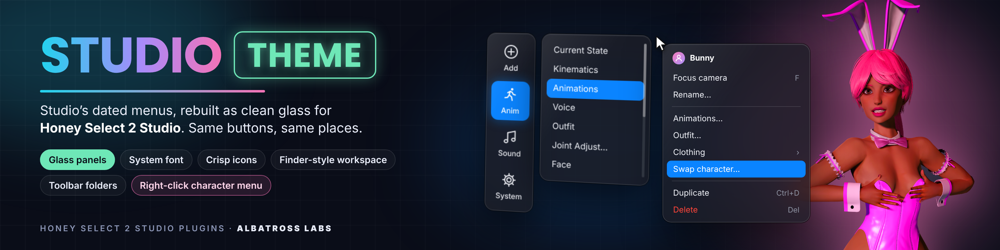

  <b>Studio's dated menus, rebuilt as clean glass.</b> 
  A BepInEx plugin for Honey Select 2 Studio (StudioNEOV2) by Albatross Labs. 
  <a href="https://github.com/AlbatrossLabs/HS2StudioTheme/releases/latest">Download</a> ·
  <a href="#install">Install</a> ·
  <a href="#settings">Settings</a> ·
  <a href="docs/DEVELOPMENT.md">Developer notes</a>

---

Studio Theme restyles every menu, list and panel in Studio with glass panels, the Windows system font and crisp line icons. Buttons stay where they were and do what they always did, so there's next to nothing to relearn. Turn it off from the settings and Studio's original look is back instantly, without a restart.

## Highlights

- **Glass everywhere.** The main menu, every list and panel that Add, Anim, Sound and System open, the Exit dialog, the sound players and the gizmo panel, all in one consistent look with Apple-style check boxes, sliders, fields and dropdowns.
- **Finder-style workspace.** Type icons, eye and fold chevrons, an object count, a full-width selection bar, and a corner grip to resize it.
- **Column-view pickers.** Animations and items open as Finder columns, with a breadcrumb of the path you took.
- **Right-click menu.** Right-click a character in the scene, or anything in the workspace: focus the camera, hide, rename, duplicate, delete, jump to its panels, toggle FK / IK, and set clothing On / Half / Off. KKAPI's workspace items (and other plugins' items there) are included.
- **iPhone-style toolbar folders.** Drag tool buttons onto each other to group them. Buttons keep the places they already had and can be dragged anywhere on screen.
- **A better camera bar.** One centred capsule for saved views, a scene-camera menu, and a per-camera **culling distance** that lets a camera see past walls and props (saved with the scene).
- **Small things that add up.** Empty accessory slots fold away, On / Half / Off rows become small sliders, long names scroll on hover instead of shrinking, poses stay frozen at their moment, and FK nodes are colour-coded left blue / right red.
- **Other plugins fit in.** Panels and buttons from MoarCamz, HS2PE, FK & IK, HSUS, Timeline, Material Editor and other KKAPI toolbar buttons pick up the same look.

## Requirements

- Honey Select 2 with **BepInEx 5** and **HS2API (KKAPI)**. Any recent BetterRepack has both.
- Optional: MoarCamz, HS2PE, FK & IK, HSUS. Their panels and buttons are themed too.

Studio Theme only loads in Studio. The main game is untouched.

## Install

1. Close the game.
2. Download the latest zip from [Releases](https://github.com/AlbatrossLabs/HS2StudioTheme/releases/latest).
3. Extract it into your Honey Select 2 folder (the one with `HoneySelect2.exe`). Everything lands in `BepInEx\plugins\HS2StudioTheme\`.
4. Start Studio. The theme is on straight away.

To update, overwrite the old files. To uninstall, delete the `HS2StudioTheme` folder.

## Using it

| To do this | Do this |
|---|---|
| Open a character's or object's menu | Right-click it in the scene or in the workspace |
| Rename something | Right-click › *Rename…* (names are saved with the scene) |
| Make a toolbar folder | Drag a tool button onto the middle of another |
| Move a toolbar button | Drag it anywhere on screen; hold near a taken spot and the others make room |
| Go to a saved view | Click its number in the camera bar |
| Save the current view | Click the thin strip above a number, or click an empty slot |
| See past a wall | MoarCamz settings › *Clip:* (or the camera menu without MoarCamz) |
| Give a camera its own Graphics preset | Camera settings › *Set camera graphics preset* (bottom right), camera menu › *Graphics preset*, or right-click a view number › *Graphics preset* (needs the Graphics plugin) |
| Resize the workspace | Drag the grip in its bottom-left corner |
| Turn the theme off | F1 › Studio Theme › *Enabled* |

## Settings

Press **F1** (Configuration Manager) and open *Studio Theme*.

| Setting | Default | What it does |
|---|---|---|
| Enabled | on | Off puts Studio's original look back immediately. |
| Accent colour | `0A84FF` | The selection colour. Light accents get dark text automatically. |
| Glass opacity | 0.86 | Lower shows more of the scene through the panels; higher reads better over bright scenes. |
| Labels under menu icons | on | The words under Add / Anim / Sound / System. |
| Font | Segoe UI | Any font installed in Windows. Japanese falls back to Yu Gothic UI or Meiryo. |
| Theme other plugin panels | on | Gives controls that other plugins add to Studio's panels the same look. |
| Workspace custom size | 0, 0 | Set by dragging the workspace's corner grip. 0, 0 is the default size. |
| Toolbar folders | empty | Your toolbar layout and folders. Empty keeps every button where Studio / KKAPI put it. |
| Toolbar grid at the left | off | On: the tool buttons stay in a tidy grid at the left, one row above the gizmo panel. Off: anywhere on screen. |
| Right-click character menu | on | The right-click menu in the scene and the workspace. |
| Freeze the animation when a pose is loaded | on | Keeps a loaded pose at its saved moment instead of letting the animation play on. Works with Studio's Pose list, Studio Browser and Pose Tools. |
| Colour-coded FK nodes | on | Colours FK nodes by body part while Studio's FK colours are still the defaults. |
| Apply FK colours now | off | Switch on to apply the FK colours at any time. |
| Log performance | off | Writes the theme's heaviest per-frame work to the log every 5 seconds. Handy for bug reports. |

## Everything it changes

The full, detailed list

- **Main menu column:** a tinted glass panel with line icons (Tabler Icons, MIT) and a label under each one. The open menu gets an accent-coloured tile.
- **Lists (Girls / Boys / Item..., Current State / Kinematics..., Game BGM..., Config / Save / Load...):** glass panels with rounded corners and a hairline border, left-aligned rows in the Windows system font, a soft highlight on hover, the accent colour on the selected row, and a thin scroll thumb.
- The four lists end where the main menu column's glass ends, so the first two levels line up top and bottom. Their rows start 10 units from the top and stop 10 from the bottom (Studio left 20 and 25 for its old frame), so every row of System, *End* included, fits without scrolling.
- **Exit dialog** (System › End, or closing the window; themed each time Studio makes it): a glass card on a softer dim, the question in the system font, and two capsule buttons, yes in the accent colour. The game's texts are restyled in place, so translations still apply.
- Rows that other plugins add (*Search...*, *fixed system*) are picked up when the list opens, including rows a plugin makes by copying an existing, already-themed row.
- **System panels:** glass backgrounds, section headers as soft bands with a disclosure chevron (down when open, right when folded), Apple-style check boxes and radio buttons, sliders with a thin track, accent fill and round knob, rounded text fields and dropdowns (popup list included), soft capsule buttons, a reset icon on Studio's *def* buttons, rounded colour swatches, and every label in the system font.

- **Show/hide switches** (main menu, workspace, move gizmos, color picker, map and object controls, camera bar): one glass capsule in the top-right corner with a line icon each. A tinted switch means its panel is showing, a dim one means it's hidden. Hovering shows the name and state, e.g. *Workspace: shown*.
- **Camera bar:** one glass capsule centred at the top. Numbered pills go to a saved view; the thin strip above each one saves the current view to it. With MoarCamz, the pills follow its slot colours: dimmed when empty, accent when it's the current view, accent tint for the last one loaded. The camera selector (a themed dropdown) sits at the right end. The capsule is the same height as the show/hide switches' and the same 8 units from the top of the screen: each slot is a 6-unit save strip over a 22-unit load pill, and MoarCamz's strip is trimmed to that row. The bar re-centres itself as MoarCamz slots are added or removed.

- **Anim panels:** the character panels (State, Kinematics with FK / IK / Gaze / Neck / Face / Hands / Save pose, Animations, Voice, Outfit, Joint), the item, light, folder, route and camera panels, and the floating animation controller, external image and route windows. Panels are glass; section headers fold with a chevron; buttons whose text Studio paints into the picture (On / Half / Off, None / Some / Lots, Front / Camera / Away / Fixed / Control / Anim, Save / Load / Import / Delete, Apply pose to IK...) are drawn as capsules with that text in the system font; icon buttons (restart, copy, paste, play, stop, repeat...) get line icons with tooltips; panel titles and section labels Studio paints in (Face: Eyebrows / Eyes / Mouth, Voice: Character / Type / Line, Light controller...) are written out at the same place.
- **Kinematics and Joint Adjustment:** Kinematics' FK / IK / Gaze / Neck / Face / Hands / Save pose panels are themed like the rest (they sit next to Kinematics' list, which had made the theme mistake them for hidden list templates).
- HS2PE's extra joint rows (Crotch, Ankles), which it hangs under Joint Adjustment's bottom edge on a grey strip, sit on the panel's glass inside it.
- Labels that started right at the panel edge (Studio's old pictures had a frame) start 10 units in; the per-part "個別参照" buttons read *From anim*; Kinematics' panels and Joint Adjustment grow at the bottom if their last row would touch or pass the edge (`PanelFit`).
- **Add panels:** the Girls / Boys character lists (sort by Name / Date with a chevron showing the direction, card preview on glass, Load in the accent colour and Change character as a solid glass button, since both sit on the open scene), the item group → category → item picker as a column view (same as the animation picker below), and the map, light, background and frame lists.
- **Animation picker** (Anim > Animations): a Finder-style column view. The group, category and animation columns are narrower (104 units, 6 apart: Studio's 90-wide rows plus a thin scroll bar), each has a title, rows that open another column have a chevron, and only the current pick is accent: the path you took shows grey in the earlier columns (including *Animations* in Anim's own list). A breadcrumb under the columns spells out the path, e.g. *Animations › Character › Standing › Idle 2*.
- **Workspace** (the object list): one glass window with the title and an object count (*12 objects*). Rows read like a Finder or Xcode sidebar: a chevron to fold (only on rows with children), an eye that turns into a crossed-out eye when the object is hidden (its name dims too), a line icon for the kind of object (character, item, light, folder, route, route point, camera) tinted with Studio's colour for that kind, and the name in the system font. The selection is a full-width accent bar, multi-select included; hovering a row shows a faint bar. The toolbar buttons keep their places and get line icons with tooltips: Delete (red), New folder, New camera, New route, Unparent, Parent, Copy, Duplicate. Thin scroll bars.
- **Workspace placement and resize:** the window starts right under the show/hide switches, exactly as wide as them and lined up with their right edge (it can still be dragged by its title bar). Its top-right corner stays put; drag the grip in the bottom-left corner to resize (it snaps back to the switches' width when you get close). The size is remembered (setting *Workspace custom size*; 0, 0 = the switches' width, Studio's height).
- **Workspace toolbar:** 30-unit square buttons in rows along the bottom, right-aligned, as many per row as fit (6 at the default width), in Studio's order with plugin buttons slotted in where their plugin put them; Delete sits on its own at the bottom left. The horizontal scroll bar sits just above the rows and the list fills the rest.
- **Long text scrolls instead of shrinking:** one-line labels (list rows, buttons, panel labels like *Right Forearm Group*) keep their size. Text that doesn't fit ends in "…"; point at it and the whole text scrolls across, pauses, and scrolls back.
- **Gizmo panel (bottom left):** one glass panel with *Position* / *Rotation* / *Scale* rows, X / Y / Z in Apple's red, green and blue, rounded fields, and the *def* buttons as reset icons. Move / Rotate / Scale are one segmented control (a glass capsule around three icon buttons) with the current mode in the accent colour. With HSUS's *Improved Transform Operations*, its Copy / Paste / Reset Transform box becomes glass with capsule buttons, Reset in red.
- **MoarCamz controls:** the settings and center buttons sit at the left end of the camera bar and **+** (add a slot) and **−** (remove the last extra slot) right after the camera numbers (the settings button turns accent while the settings show). The camera settings are one glass card centred under the camera bar, the same gap below it as the workspace under the switches: rounded fields, the themed FOV slider, *Pos:* / *Rot:* as capsules with the active one in the accent colour, the lock and target buttons as icons, and the drag pads (XZ, X, Z, Y, distance) as soft rounded tiles with line icons. *Dis:*, *FOV:* and *Clip:* boxes are as wide as the *Pos:* boxes, the drag pads start level with the *Pos:* row, and the XZ / XY switch sits level with the *Y* and *Dis* labels. Under *FOV:* is **Clip:**, the camera's culling distance (a number and a slider; anything closer to the camera isn't drawn, so it can see past a wall or a prop; saved per camera with the scene; click *Clip:* to reset). At the card's bottom right, level with *Clip:*, is **Set camera graphics preset** (with the Graphics plugin, 3.x or 0.5): a dropdown with your Graphics presets and *Default*; the camera in use loads the one you pick whenever you switch to it, and the button then shows its name. Without MoarCamz the culling slider is in the camera menu.
- **Scene cameras:** Studio's camera dropdown (switch between camera objects added to the scene) is replaced by a button at the right end of the camera bar showing the active one (*Free camera* when none). It opens a glass menu right under the camera bar, right edges lined up and the same size as the rest of Studio's UI: *Free camera* and each scene camera with a tick on the active one, *Add camera to the scene* (the workspace's new-camera button), and a **Culling distance** slider for the camera in use: anything closer to the camera than this isn't drawn, so a camera can see past a wall or a prop in front of it. Each camera (the free one included) keeps its own distance, saved with the scene (through KKAPI); *Reset culling distance* puts Studio's 0.10 back. Studio's dropdown is still there underneath, hidden, and does the switching. With the Graphics plugin installed, the menu also has **Graphics preset** for the camera in use (on the free camera, for the view last loaded or saved): pick one of Graphics' presets, or *Default* (Graphics' own default look for Studio, the one it loads at startup), and switching to that camera loads it. Cameras without a preset are on *Default*, but only once some camera in the scene has a preset, so a scene that doesn't use presets keeps its own Graphics settings. Graphics presets are the whole look (lights, sky, shadows, post-processing), so save a preset per look in Graphics and give each camera the one it needs. Saved with the scene; Camera Sweep 0.9.7 or later shoots each camera with its preset.
- **Camera slots:** three show by default, plus every slot with a view saved in it. Click a numbered pill to go to its view; click the thin strip above a pill to save the current view to it; click an empty slot (MoarCamz greys those) to save there too. With MoarCamz, **+** shows the next hidden slot (and adds a new MoarCamz slot once all are showing), **−** removes the last extra slot, and the camera menu has *Clear view …* for each saved view. Right-click a number for its own menu: go to the view, save to it, clear or remove it, and (with the Graphics plugin) give it a **Graphics preset**. The strip and the camera button shrink to fit, so the bar stays compact.
- **Right-click menu (scene characters and workspace rows):** right-click a character in the scene (a click, not a camera drag), or any row in the workspace, for a glass context menu with its name on top (KKAPI's workspace menu items, such as *Select children* and other plugins' entries, are added at the bottom instead of KKAPI opening its own menu on top):
  - Workspace utilities: *Select in workspace* (from the scene), *Focus camera* (Studio's F), *Hide* / *Show*, *Rename…*, *Duplicate* (Ctrl+D), *Delete* (red, Studio's own confirmation).
  - *Rename…* opens a small box with the name selected: Enter or a click elsewhere keeps the new name, Esc cancels, and Studio's keyboard shortcuts stay quiet while you type. Folders, routes and cameras keep it as their own name; characters', items' and lights' new names are saved with the scene by the theme (through KKAPI) and put back when it's loaded.
  - Characters: *Current state…*, *Kinematics…*, *Animations…*, *Outfit…* select the character, open Anim and the matching page (with Studio Browser installed, Outfit brings up the outfit browser as usual); *Swap character…* selects them and opens Add › Girls / Boys for their sex, so Studio's *Change character* swaps in another card with the same pose and position; *FK* / *IK* switches with a tick when on; *Clothing ›* opens a flyout beside the menu with each part they're wearing (Top, Bottom, Bra, Underwear, Gloves, Pantyhose, Socks, Shoes) and All, each with On / Half / Off (current state accent, unavailable states dimmed; stays open for several changes).
  - Other objects: *Settings…* selects it and opens Anim, where Studio shows its panel.
  - Right-clicking a workspace row selects it first, as Finder does. Esc, a click elsewhere or another right-click closes the menu. F1 › *Right-click character menu* turns it off.
- **Animations with FK / IK on:** in Anim › Animations, when the character (or a selected one) has FK or IK on, a yellow note under the breadcrumb says the animation won't move the posed parts, with a **Turn off** button that switches FK and IK off for them.
- **Colour-coded FK nodes:** while Studio's character FK colours are still its factory white, each part gets its own colour on start: left hand blue, right hand red, body yellow, head and neck orange, hair purple, chest pink, skirt cyan (the usual rigging left-blue / right-red convention). F1 › *Apply FK colours now* sets them any time; F1 › *Colour-coded FK nodes* off leaves Studio's alone.
- **On / Half / Off as sliders:** Studio's rows of tiny state buttons (clothes, accessories, All Clothes, and None / Some / Lots) are drawn as a small three-stop slider: a thin track through the buttons, a dot per stop (dimmed if that state isn't available), the current state as an accent knob, and its name to the right when the row has room. Hovering a stop shows a faint knob there and its name. Studio's buttons stay where they were as invisible click targets.
- **Empty accessory slots fold away:** in Current State, accessory slots the character has nothing in (Studio greys them out) leave the list, so only the worn ones show. They come back as soon as the slot has something in it. Extra slots a plugin adds past Studio's twenty (by copying a row) are picked up too, and their On / Off sliders rebuilt.
- **Other plugins' panels:** controls that plugins add to Studio's panels after start-up get the same look (check boxes, sliders, buttons, fields, labels, glass). A plugin that copies an already-themed page (FK & IK copies Kinematics' FK page and paints its own title on it) gets glass again with the copy's own name as the title, a working themed slider, and labels at one size that end in "…" and scroll on hover instead of shrinking. Rows of Studio's lists are left to the lists. F1 › *Theme other plugin panels* turns this off.
- **Fields:** TextMeshPro fields (Config numbers, the gizmo panel, MoarCamz) get rounded backgrounds and their own text recoloured in place, so typing works as before. Numbers keep shrinking to fit their box; only words scroll.
- **Tool buttons (bottom left):** object and map controls, camera target, gizmo axes, camera free / locked, gimmicks, move handle, center point, undo and redo are small glass squares with line icons and tooltips, in Studio's places. On/off states show in the accent colour; the camera button's icon switches between a camera (free) and a lock (locked, hold Alt to move the camera); Undo / Redo dim when there's nothing to undo / redo.
- **Toolbar folders:** iPhone-style. Every button keeps the place it already had (KKAPI's, including any you set yourself), and you can drag it to any spot on screen on KKAPI's grid. Over the middle of another button nothing moves and that button grows: let go to put both in a folder (named *Tools*, *Plugins* or *Folder* by what's in it; click the name in the open folder to rename it), or over a folder to add it. Near the edge of a taken spot, hold for a moment and the buttons make room (pushed down the column, up to the first gap). Click a folder (a glass square showing up to four of its icons) to open it: a glass panel beside it with its buttons, which work as usual; a click elsewhere or Esc closes it. Drag a button out of the open folder to take it out; a folder left with one button turns back into that button. KKAPI's own toolbar drag handler is switched off on these buttons while the theme is on, so a drag only moves it once. F1 › *Toolbar grid at the left* keeps the buttons in a tidy grid at the left instead, stopping one row above the gizmo panel. The layout is saved in F1 › *Toolbar folders* (empty = where Studio and KKAPI put them).
- **Tooltips everywhere:** a tooltip shows above its button when another button sits right under it (the workspace's toolbar rows, the left toolbar's columns), so it never covers the next row.
- **Tooltip text:** every tool button shows one tooltip (the theme's; KKAPI's own is switched off for those buttons so they don't double up), with Studio's shortcut where it has one (Undo Ctrl+Z, Redo Ctrl+Shift+Z, gizmo axes Q, move handle J, center point K, Move W / Rotate E / Scale R) and, for plugin buttons, the plugin's name. Plugin buttons the theme has no icon for keep their own picture on a glass square.
- **Plugin buttons:** known plugins' 32-pixel toolbar pictures are replaced with line icons. Left toolbar (glass squares, KKAPI's tooltips kept): QuickAccessBox (search), Timeline (yellow icon when the scene has Timeline data, accent while playing), PoseEditor, VideoExport (red record dot), NodesConstraints, Hooah, ObjectMap, extra gizmos, transform orientation, Graphics. Workspace toolbar (with tooltips): Material Editor, Custom Masking, the accessory controller. Unknown plugins' buttons keep their own pictures.
- **Sound players** (BGM, environment sound, external sound): glass panel with its title written in the system font (Studio's titles are painted into the panel picture), transport buttons with line icons (Play turns accent while something is playing, Repeat while it's on), a chevron for the track list, and the track list as themed rows with the playing track in the accent colour. Long track names keep Studio's scrolling effect.

## Known limits

- A few picture buttons still use Studio's original art.
- The glass is a tint. There's no real background blur.

## Credits

- Made by **Albatross Labs**.
- Icons: [Tabler Icons](https://tabler.io/icons) (MIT). See `res/LICENSE-tabler-icons.txt`.
- Built on [BepInEx](https://github.com/BepInEx/BepInEx), [HarmonyX](https://github.com/BepInEx/HarmonyX) and [IllusionModdingAPI](https://github.com/IllusionMods/IllusionModdingAPI).

## Licence

MIT. See [LICENSE](LICENSE).
